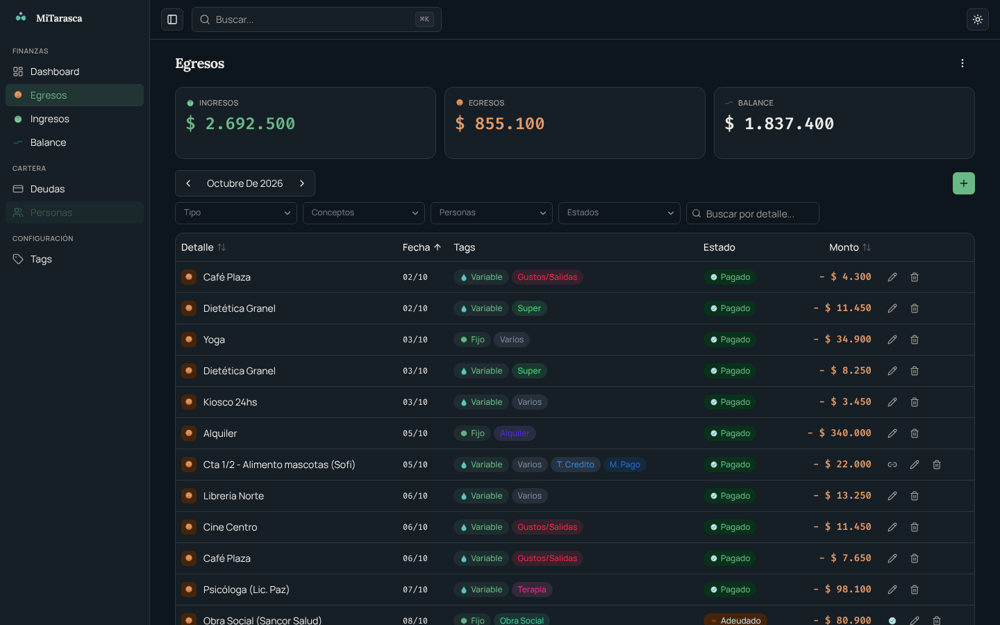
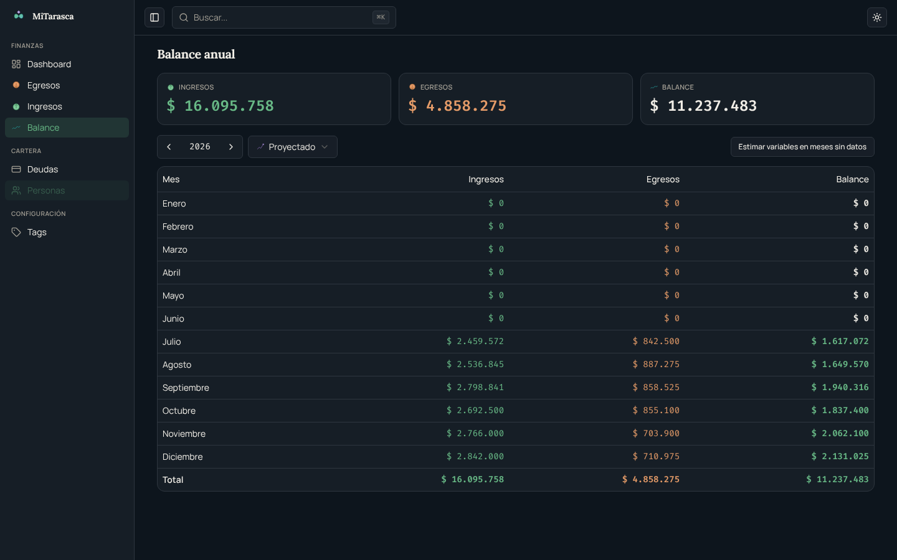
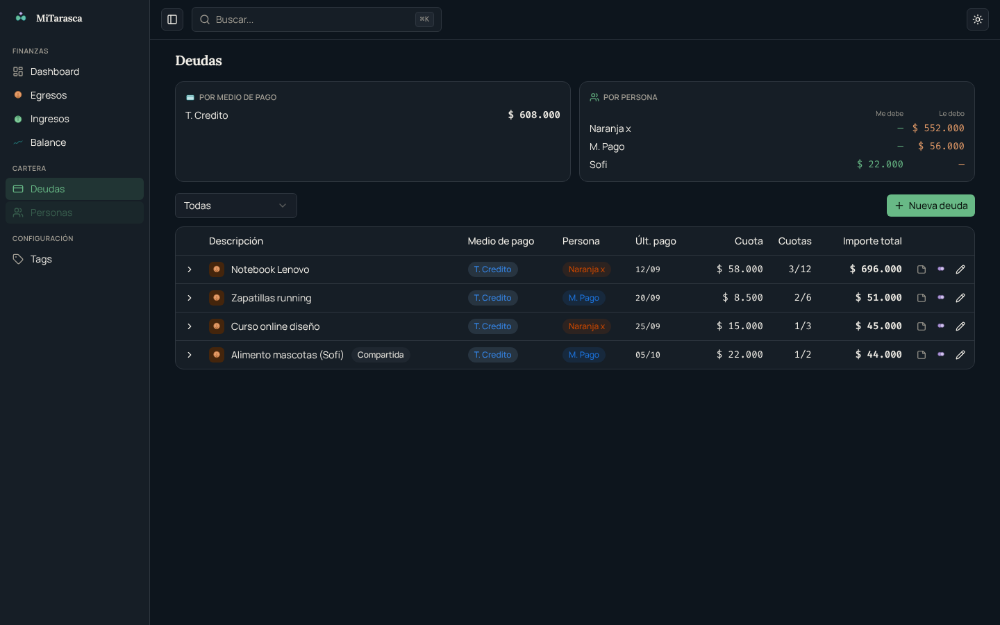

<a id="readme-top"></a>

[![CI][ci-shield]][ci-url]
[![License: MIT][license-shield]][license-url]

<br />
<div align="center">
  <h1>MiTarasca</h1>
  <p align="center">
    La plata que se va, con nombre y apellido.
    <br />
    <em>Movimientos, deudas y cuotas, balance mensual y anual. Todo en un SQLite que es tuyo.</em>
    <br />
    <br />
    <a href="https://mitarasca.demo.lucianodlf.com.ar"><strong>Ver la demo</strong></a>
    ·
    <a href="./docs/features.md">Features</a>
    ·
    <a href="#quickstart">Quickstart</a>
  </p>
</div>

## Tabla de contenidos

- [Sobre el proyecto](#sobre-el-proyecto)
- [Capturas](#capturas)
- [Qué hace hoy](#qué-hace-hoy)
- [Quickstart](#quickstart)
- [Modo desarrollo](#modo-desarrollo)
- [Docker](#docker)
- [MCP](#mcp)
- [Configuración avanzada](#configuración-avanzada)
- [Arquitectura](#arquitectura)
- [Estado del proyecto](#estado-del-proyecto)
- [Contribuir](#contribuir)
- [Licencia](#licencia)

## Sobre el proyecto

En el Río de la Plata, la *tarasca* es la plata que hay que pagar. MiTarasca no promete
que vas a tener más plata: te muestra de frente lo que se va todos los meses, con nombre y
apellido. Qué es fijo, qué es variable, qué está pagado y qué está adeudado.

Los datos viven en un archivo SQLite en tu máquina. Sin cuenta, sin nube obligatoria.

La [demo](https://mitarasca.demo.lucianodlf.com.ar) corre con datos inventados.

<p align="right">(<a href="#readme-top">volver arriba</a>)</p>

## Capturas







<p align="right">(<a href="#readme-top">volver arriba</a>)</p>

## Qué hace hoy

- **Movimientos con contexto**: ingresos y egresos clasificados con tags en cinco
  dimensiones (tipo, concepto, estado, medio de pago y persona).
- **Prorrateo**: el monto que pagaste y el que te toca, guardados por separado.
- **Template mensual de fijos**: genera el mes nuevo a partir del anterior.
- **Deudas en las dos direcciones** (*yo debo* y *me deben*), con cuotas automáticas,
  vínculo cuota y movimiento al pagar, y deudas compartidas.
- **Balance** proyectado, real y con estimación de variables futuras.
- **Cuatro puertas al mismo dominio**: web, CLI, MCP (18 tools para asistentes de IA) y
  API tRPC.
- **Importación desde capturas** de una billetera virtual (experimental).

Detalle de cada feature, su madurez y sus limitaciones en
[`docs/features.md`](./docs/features.md).

<p align="right">(<a href="#readme-top">volver arriba</a>)</p>

## Quickstart

Instalación simple en Linux. Requiere `git`; si falta [Bun](https://bun.sh), el script
ofrece instalarlo.

```bash
git clone https://github.com/lucianodlf/mitarasca.git
cd mitarasca
./scripts/install.sh
```

Sin clonar a mano (clona en `~/.local/share/mitarasca`):

```bash
curl -fsSL https://raw.githubusercontent.com/lucianodlf/mitarasca/main/scripts/install.sh | bash
```

El script instala las dependencias, buildea la web, crea tu base vacía y deja el comando
`mitarasca` en `~/.local/bin`. Volver a correrlo actualiza. Después:

```bash
mitarasca demo      # siembra la base de demo (datos inventados) y abre la web
mitarasca ui        # abre la web con tu base (alias: mitarasca web)
mitarasca --help    # todos los comandos
```

Cualquier comando acepta `--demo` para trabajar sobre la demo sin tocar tu base
(`mitarasca balance --demo`). Para desinstalar, `mitarasca uninstall`: quita el comando del
PATH, no borra datos y te muestra dónde quedaron, con el `rm -rf` para borrarlos.

Próximamente: paquete en npm. macOS y Windows todavía no tienen instalador.

<p align="right">(<a href="#readme-top">volver arriba</a>)</p>

## Modo desarrollo

Desde un clon, con `bun install` hecho:

```bash
bun run db:seed:demo      # genera ./data/demo.db con datos inventados
bun run dev:demo          # API (http://localhost:3787) y web (http://localhost:5173) sobre la demo

bun run db:init           # crea ./data/mitarasca.db vacía (migraciones y tags base)
bun run dev               # API y web sobre tu base
```

Con algunas versiones de Bun `bun run dev` solo arranca la API; en ese caso, usar dos
terminales con `bun run dev:api` y `bun run dev:web`.

```bash
# CLI desde el repo, sin instalar
bun packages/cli/src/index.ts --help

# Typecheck, lint y tests
bun run typecheck
bun run lint
cd packages/core && bun test
```

<p align="right">(<a href="#readme-top">volver arriba</a>)</p>

## Docker

La imagen trae la web y la API, sin la CLI. Los datos van en `./data-docker/` (nunca en
`./data/`). Crear la carpeta con tu usuario antes del primer uso: si la crea Docker queda de
root y la imagen corre como uid 1000.

```bash
mkdir -p data-docker

# Base vacía
docker compose run --rm api bun packages/core/scripts/init-db.ts
docker compose up --build

# Demo
docker compose run --rm api bun packages/core/scripts/seed-demo.ts
MITARASCA_DEMO=1 docker compose up --build
```

La web queda en http://localhost:3787.

<p align="right">(<a href="#readme-top">volver arriba</a>)</p>

## MCP

`mitarasca mcp` levanta el servidor MCP por stdio (18 tools; 10 escriben). Se configura a
mano en el cliente. Con Claude Code:

```bash
claude mcp add -s user mitarasca -- mitarasca mcp --demo   # todos tus proyectos, sobre la demo
claude mcp add -s project mitarasca -- mitarasca mcp       # solo este proyecto (.mcp.json), tu base
```

Claude Desktop, otros clientes y las limitaciones en la [guía del MCP](./docs/guias/mcp.md).

<p align="right">(<a href="#readme-top">volver arriba</a>)</p>

## Configuración avanzada

La base se resuelve en este orden:

1. `DB_PATH`, si está seteado (usar ruta absoluta).
2. `--demo` o `MITARASCA_DEMO=1`: `data/demo.db` del clon.
3. `db_path` del `.mitarasca/config.toml` más cercano subiendo desde el directorio actual.
4. `db_path` de la config global, `~/.config/mitarasca/config.toml`.
5. `data/mitarasca.db` del clon.

Solo `mitarasca init` y `mitarasca demo` crean la base: el resto de los comandos, la API y el
MCP avisan qué correr si no existe.

```bash
mitarasca config set db_path /ruta/absoluta/a/mitarasca.db   # config global
mitarasca config path                                         # qué archivos lee
mitarasca ui --port 4000                                      # otro puerto (la API sola usa API_PORT)
```

`MITARASCA_DEBUG=1` muestra el stack completo de los errores de la CLI.

Guías, con el nivel de madurez de cada parte:

- [CLI](./docs/guias/cli.md)
- [MCP](./docs/guias/mcp.md): Claude Code y Claude Desktop.
- [Skill `importar-movimientos`](./docs/guias/importar-movimientos.md) (experimental).

<p align="right">(<a href="#readme-top">volver arriba</a>)</p>

## Arquitectura

Monorepo Bun workspaces con un paquete de dominio puro consumido por tres frontends y una
SPA:

```
packages/core   → dominio + SQLite/Drizzle (sin HTTP, sin framework)
packages/api    → expone core vía tRPC sobre Hono
packages/cli    → expone core vía comandos commander (in-process)
packages/mcp    → expone core vía MCP tools (stdio, in-process)
packages/web    → SPA Vue 3 que consume packages/api por HTTP (tRPC client)
```

Las reglas de negocio viven solo en `core`; los demás paquetes traducen su entrada a las
funciones del dominio. Más detalle en [`docs/architecture.md`](./docs/architecture.md).

<p align="right">(<a href="#readme-top">volver arriba</a>)</p>

## Estado del proyecto

Proyecto personal, publicado para portfolio. La web y la API son la forma
principal de uso. El CLI y el MCP cubren lectura y escritura de movimientos y deudas, con
algunas partes experimentales. La importación desde capturas está ajustada a un caso de uso
propio. El estado de cada parte está en [`docs/features.md`](./docs/features.md).

Se instala desde un clon del repo con `scripts/install.sh` (solo Linux). Todavía no hay
paquete publicado en npm.

<p align="right">(<a href="#readme-top">volver arriba</a>)</p>

## Contribuir

Es un proyecto personal, pero los issues y las contribuciones son bienvenidos. Antes de
proponer un cambio grande, abrí un issue para charlarlo.

<p align="right">(<a href="#readme-top">volver arriba</a>)</p>

## Licencia

Distribuido bajo la licencia MIT. Ver [`LICENSE`](./LICENSE).

<p align="right">(<a href="#readme-top">volver arriba</a>)</p>

[ci-shield]: https://github.com/lucianodlf/mitarasca/actions/workflows/ci.yml/badge.svg
[ci-url]: https://github.com/lucianodlf/mitarasca/actions/workflows/ci.yml
[license-shield]: https://img.shields.io/badge/license-MIT-blue.svg
[license-url]: ./LICENSE
