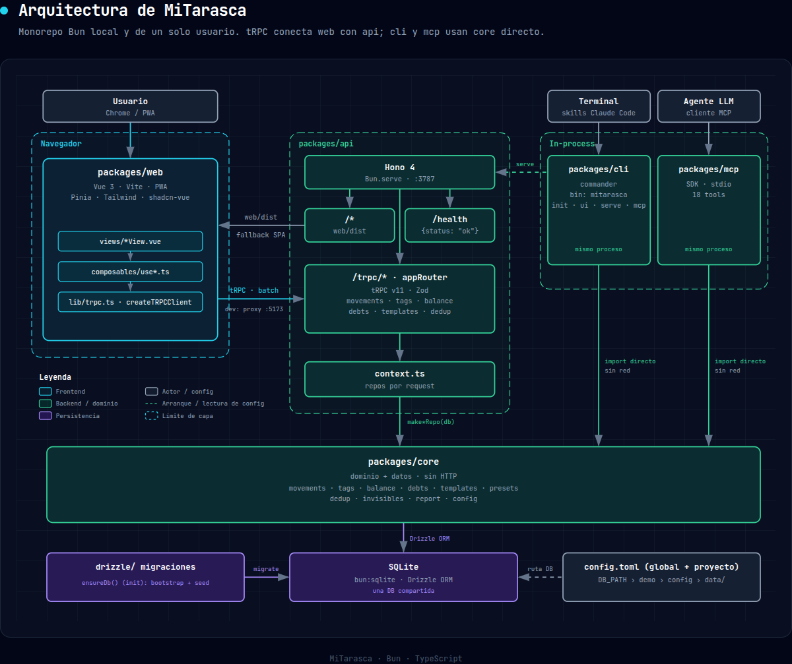
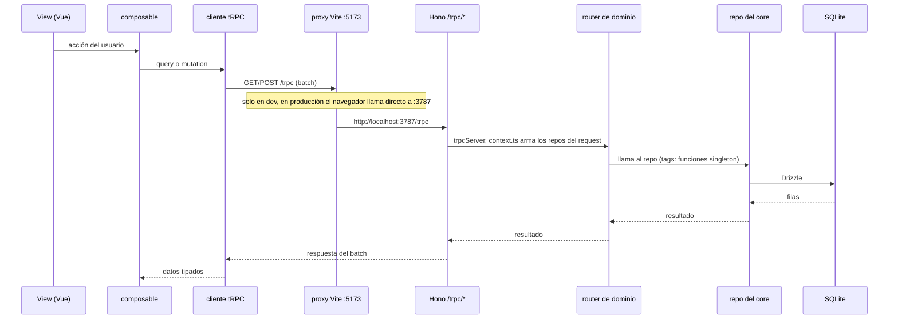

Mitarasca es un monorepo Bun de una app local de finanzas personales (un solo usuario, sin servicios cloud). El eje de comunicación es tRPC entre la SPA `web` y `api`; `cli` y `mcp` no usan tRPC.

## 1. Capas y componentes

**Cliente (navegador)**
- `packages/web`: SPA Vue 3 con vue-router, Pinia, Tailwind v4, shadcn-vue/reka-ui, @tanstack/vue-table y vue-sonner. Se construye con Vite 6 y vite-plugin-pwa (PWA, `registerType: autoUpdate`).
- Patrón interno: `views/*View.vue` → `composables/use*.ts` → `lib/trpc.ts`. Los `components/<dominio>` son solo presentación.

**Servidor**
- `packages/api`: Hono sobre `Bun.serve`, puerto 3787 (`API_PORT`). Rutas:
  - `/trpc/*`: adaptador `@hono/trpc-server` con `appRouter` (tRPC v11, validación con Zod).
  - `/health`: devuelve `{status:"ok"}`.
  - `/*`: sirve `web/dist` como estático, con fallback a `index.html` (SPA).
  - CORS de respaldo solo en `/trpc/*` (`CORS_ORIGIN`, por defecto `http://localhost:5173`).

**Dominio y persistencia**
- `packages/core`: lógica de negocio y acceso a datos, sin HTTP.
  - Módulos: `movements`, `tags`, `balance`, `debts` (+ `installments`), `templates`, `presets`, `dedup`, `invisibles`, `images/hash`, `report`, `config`.
  - Los módulos con datos tienen `*.repository.ts` (factory `make*Repo(db)`) y, salvo `presets`, `*.singleton.ts` (funciones ligadas al `db` global). `images/hash` y `config` son utilidades sin repo.
  - `src/index.ts` es el único barrel público.
  - Persistencia: Drizzle ORM sobre SQLite (`bun:sqlite`). Esquema en `src/db/schema.ts` y migraciones en `drizzle/`. `ensureDb()` hace bootstrap y seed.

**Consumidores in-process (sin red)**
- `packages/cli`: binario `mitarasca` con commander. Importa `@mitarasca/core` directamente. Incluye los comandos `install` y `serve`.
- `packages/mcp`: servidor MCP por stdio (`@modelcontextprotocol/sdk`, 18 tools con `registerTool`). Importa `@mitarasca/core` directamente.

## 2. Comunicación tRPC (prioridad)

- **Contrato de tipos:**
  - `@mitarasca/api/router` exporta solo `type AppRouter` (`router-type.ts`).
  - `web` lo importa con `import type`, así `bun:sqlite` nunca entra al bundle del navegador.
  - `web` lo declara como devDependency.
- **Cliente:** `createTRPCClient<AppRouter>` con `httpBatchLink({ url: "/trpc" })` en `packages/web/src/lib/trpc.ts`. Se usa como `trpc.movements.listByDateRange.query(...)` y `trpc.movements.create.mutate(...)`.
- **Transporte:** HTTP con batching de llamadas, sin WebSocket ni SSE.
- **En dev:** el navegador llama a `:5173/trpc` y Vite hace proxy a `http://localhost:3787` (sin CORS). Producción: web y API salen del mismo origen (Hono sirve el estático).
- **Servidor tRPC:**
  - `trpc.ts` hace `initTRPC.context<Context>()` y expone solo `publicProcedure` (sin auth).
  - `context.ts` crea en cada request los repos `movements`, `balance`, `debts`, `installments`, `templates`, `dedup` e `invisibles` sobre `getDb()`.
  - Los tags se consumen vía funciones singleton del core.
- **`appRouter`** (`src/trpc/router.ts`), con unos 41 procedures query/mutation:
  - `movements`
  - `tags`
  - `balance`
  - `debts`
  - `templates`
  - `dedup`
- **Adaptación de tipos:** `strip-undefined.ts` quita los `undefined` que produce Zod, por `exactOptionalPropertyTypes` en el core.

## 3. Flujos de conexión

1. Navegador → Vue View → composable → cliente tRPC → `POST/GET /trpc` (proxy Vite en dev) → Hono → `trpcServer` → router de dominio → repo del core → Drizzle → SQLite.
2. `cli` → `@mitarasca/core` (llamada directa) → SQLite.
3. `mcp` (stdio, agente LLM) → `@mitarasca/core` (llamada directa) → SQLite.
4. `mitarasca serve`, `ui` o `demo` (CLI) → `assertDbExists()` (no crea la base; falla si no existe) → importa `@mitarasca/api` y lo levanta con `Bun.serve`, sirviendo también `packages/web/dist` (`web-dist` en el bundle de release).
5. Los tres puntos de entrada (`api`, `cli`, `mcp`) comparten la misma DB.

El flujo 1, paso a paso:

## 4. Configuración y datos locales

- **Ruta de la DB (`resolveDbPath` en `packages/core/src/db/client.ts`), en orden; gana el primer paso que aplica:**
  1. `DB_PATH`, si está seteado. Usar una ruta absoluta.
  2. `MITARASCA_DEMO=1` (lo activa `--demo`): `data/demo.db` dentro de la carpeta del repo.
  3. `db_path` de la config (`loadConfig` en `packages/core/src/config.ts`). Se lee la config global (`~/.config/mitarasca/config.toml`, o `$XDG_CONFIG_HOME/mitarasca/config.toml`) y encima la del proyecto: el `.mitarasca/config.toml` más cercano subiendo desde el directorio actual. Si las dos tienen `db_path`, gana la del proyecto. Una ruta relativa se resuelve desde la carpeta que contiene `.mitarasca/` (o desde el directorio actual si no hay ninguna). El repo trae un `.mitarasca/config.toml` que apunta a `./data/mitarasca.db`.
  4. `data/mitarasca.db` dentro de la carpeta del repo. Con el instalador por `curl` (`scripts/install.sh`, que clona en `~/.local/share/mitarasca/`) es; si se corre desde un repo clonado a mano, es el `data/` de esa carpeta. Con `curl`: `~/.local/share/mitarasca/data/mitarasca.db`.

  Nota sobre el bundle de release: `scripts/build-release.ts` define `MITARASCA_INSTALLED=1`. Con esa variable, la demo pasa a `$XDG_DATA_HOME/mitarasca/demo.db` y, entre los pasos 3 y 4, se usa `$XDG_DATA_HOME/mitarasca/mitarasca.db` (por defecto `~/.local/share/mitarasca/`). Hoy ese bundle no se distribuye y el instalador no define la variable.
- **Directorios en `config.toml` `[paths]`:** `inbox`, `imports`, `processed` y `backups`.
- **Release (`scripts/build-release.ts`):**
  - Vite build de la web.
  - `Bun.build` del CLI como entrypoint único.
  - Copia de `drizzle/`, `web-dist` y `assets` de skill a `dist-release/`.
  - Escribe `dist-release/package.json` con el nombre `@lucianodlf/mitarasca`. No publica: todavía no hay paquete en npm.

## 5. Tecnologías

- **Runtime y tooling:** Bun (workspaces, test runner), TypeScript 5.7, Biome (lint y formato), vue-tsc.
- **Backend:** Hono 4, tRPC 11, Zod 4, Drizzle ORM + drizzle-kit, `bun:sqlite`.
- **Frontend:** Vue 3, Pinia, vue-router 5, Vite 6, Tailwind 4, reka-ui, lucide, PWA (workbox).
- **CLI y MCP:** commander 15, `@modelcontextprotocol/sdk`.

## 6. Integraciones externas

- **Nube:** ninguna. No hay servicios cloud, auth ni APIs de terceros. Todo corre en local con SQLite en archivo.
- **Skill de Claude Code que usa el CLI:** `importar-movimientos`.